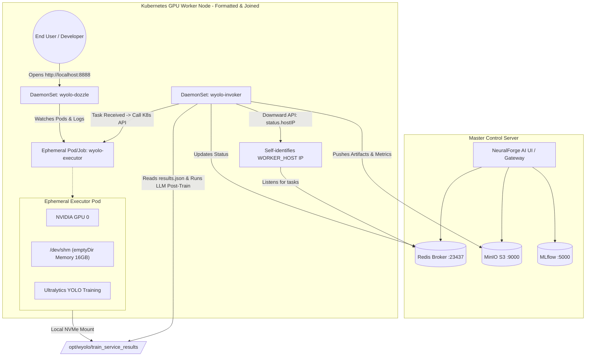

# ☸️ Kubernetes GPU Worker Compute Nodes <br> <span style="font-size:0.6em; font-weight:normal;">Autonomous DaemonSet Architecture & Zero-Config Worker Provisioning</span>


This directory contains the production-grade **Kubernetes manifests, deployment automation, and lifecycle management** for running **NeuralForge AI Worker Nodes** in a Kubernetes cluster.

It represents the cloud-native evolution of `02 workers`, transitioning from local single-node Docker Compose + Systemd daemons to **Kubernetes DaemonSets with automatic node onboarding, zero manual configuration, and native GPU scheduling**.

---

## 🛠️ Key Technologies & Ecosystem Libraries

This component leverages a curated stack of modern cloud-native, GPU computing, and messaging frameworks:

| Technology / Library | Version / Source | Role in the Ecosystem |
| :--- | :--- | :--- |
| **Kubernetes (`batch/v1`, `apps/v1`)** | `>= v1.26` | Core container orchestration. Uses **DaemonSets** to ensure every GPU node automatically runs an Invoker, and **Jobs/Pods** for ephemeral training runs. |
| **Kubernetes Downward API** | Native K8s | Injects the node's physical IP (`status.hostIP`) and hostname (`spec.nodeName`) directly into container environment variables (`WORKER_HOST`, `WORKER_HOSTNAME`), eliminating manual `.env` file management. |
| **Kubernetes RBAC** | Native K8s | Scoped `ServiceAccount`, `Role`, and `RoleBinding` granting the Invoker fine-grained permissions to programmatically create and watch Executor Pods via the in-cluster K8s API. |
| **NVIDIA Container Toolkit & k8s-device-plugin** | `nvidia.com/gpu` | Exposes physical NVIDIA GPUs to Kubernetes pods with hardware isolation and resource quotas. |
| **Dozzle Log Viewer** | `amir20/dozzle:latest` | Ultra-lightweight (15 MB RAM) real-time log streaming web UI deployed as a DaemonSet, bound to `hostPort: 8888` on each node for zero-friction user log inspection. |
| **Celery** | Python `celery` | Distributed task queue worker running inside the Invoker. Binds to global GPU priority queues (`gpus_high`, `gpus_medium`, `gpus_low`) and a private node queue (`${WORKER_HOST}`). |
| **Redis** | Central Broker | Handles Celery task brokering, cluster heartbeats, active trial registration, and hardware telemetry. |
| **PyTorch & Ultralytics YOLO** | PyTorch / YOLOv8+ | Core deep learning training engine running inside the ephemeral Executor container with GPU acceleration and `/dev/shm` shared memory scaling. |
| **MinIO & MLflow** | S3 API / REST | Object storage and experiment tracking for models, confusion matrices, and XAI forensic artifacts. |

---

## 🏗️ Architecture & Component Flow



---

## ⚡ Zero-Config Worker Node Onboarding

When a new or freshly formatted computer with NVIDIA GPUs is added to the cluster:

1. **Join the Kubernetes Cluster:**  
   The user or administrator only runs the standard join command on the machine:
   ```bash
   sudo kubeadm join <control-plane-host>:<port> --token <token> --discovery-token-ca-cert-hash <hash>
   ```
2. **Automatic DaemonSet Provisioning:**  
   Kubernetes instantly detects the new node and schedules:
   * **`wyolo-invoker`**: Automatically detects the node's real physical IP (`status.hostIP`) via the Downward API, connects to Redis, and registers its private task queue.
   * **`wyolo-dozzle`**: Automatically binds to port `8888` on the local machine (`hostPort: 8888`).
3. **No manual `.env` configuration:**  
   The user does NOT need to configure IP addresses, edit text files, or run per-machine installers.

---

## 🖥️ Viewing Logs via Dozzle

Users who previously used Portainer to inspect training logs now have an even simpler, cleaner experience:

1. Open a web browser on the worker machine:  
   👉 **`http://localhost:8888`**  
   *(Or from a remote workstation on the local network: `http://<WORKER_IP>:8888`)*
2. In the left navigation sidebar:
   * **`wyolo-invoker`**: Displays the persistent invoker daemon listening for Celery tasks.
   * **`wyolo-executor-trial-XXX`**: Appears in real time the moment a training task begins.
3. Features available in Dozzle:
   * **Live ANSI Color Streaming**: Real-time YOLO progress bars, epochs, losses, and validation metrics.
   * **Instant Search / Regex**: Filter by `epoch`, `loss`, `CUDA`, or `error` without reloading.
   * **Resource Monitoring**: Live CPU and RAM usage charts for the container.
   * **Log Download**: Single-click `.txt` download for offline inspection.
   * **Post-Training Inspection**: The Executor Pod is configured with `ttlSecondsAfterFinished: 600` (10 minutes) in state `Completed`, allowing the user to review the final epochs and metrics after training completes.

---

## 📁 Directory Structure

```
03 workers k8s/
├── Makefile                     # Operational commands (deploy, status, test-gpu, clean)
├── README.md                    # Comprehensive documentation and technology overview
├── control_host.env             # Master Control Server IP and credentials configuration
├── deploy.sh                    # Automated deployment script with idempotence checks
├── test_gpu_node.yaml           # Smoke test pod verifying NVIDIA GPU access inside K8s
├── uninstall.sh                 # Safe teardown script
└── manifests/
    ├── 00-namespace.yaml        # Dedicated 'train-service' namespace
    ├── 01-rbac.yaml             # ServiceAccounts, Roles, and RoleBindings
    ├── 02-configmap.yaml        # Global cluster ConfigMap (Redis, MinIO, MLflow)
    ├── 03-secrets.template.yaml # Secrets template for CIFS and MinIO authentication
    ├── 04-invoker-daemonset.yaml# Persistent Invoker compute node DaemonSet
    ├── 05-dozzle-daemonset.yaml # Lightweight real-time log viewer DaemonSet
    └── 06-executor-template.yaml# Reference template for ephemeral GPU Executor Jobs
```

---

## 🚀 Quickstart & Deployment Guide

### Prerequisites
1. Kubernetes cluster operational with worker nodes joined.
2. NVIDIA GPU drivers and **NVIDIA Container Toolkit / GPU Operator** installed on worker nodes (`kubectl get nodes -o custom-columns=NAME:.metadata.name,GPU:.status.allocatable.'nvidia\.com/gpu'`).
3. Master control server (Control Server 01) running Redis, MinIO, and MLflow.

### 1. Configure the Control Host
Edit `control_host.env` and set the IP of your central control server:
```env
CONTROL_HOST=192.168.10.252
```

### 2. Deploy the Worker Stack
Deploy all manifests and start the DaemonSets across all worker nodes:
```bash
make deploy
# Or directly:
./deploy.sh
```

### 3. Verify Cluster Status
Check the status of the DaemonSets and Pods:
```bash
make status
```
Expected output:
```
=== [DAEMONSETS] ===
NAME            DESIRED   CURRENT   READY   UP-TO-DATE   AVAILABLE   NODE SELECTOR
wyolo-invoker   3         3         3       3            3           <none>
wyolo-dozzle    3         3         3       3            3           <none>
```

### 4. Verify GPU Scheduling
Run the GPU smoke test to verify CUDA container capability:
```bash
make test-gpu
```

### 5. Stream Logs from CLI
To tail logs directly from your terminal:
```bash
make logs-invoker
make logs-dozzle
```

---

## 🧹 Teardown / Uninstall

To remove the worker stack from the cluster:
```bash
make uninstall
# Or directly:
./uninstall.sh
```
